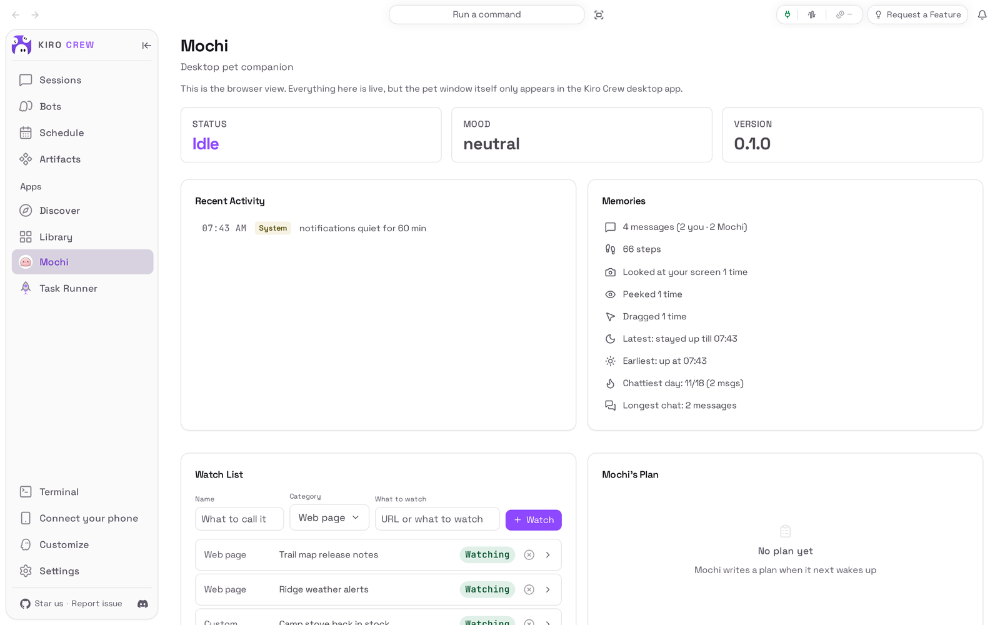
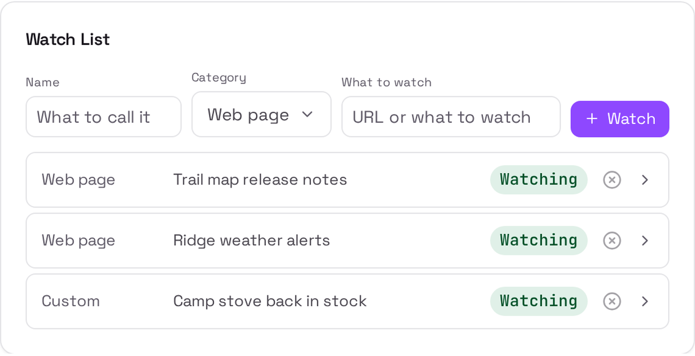
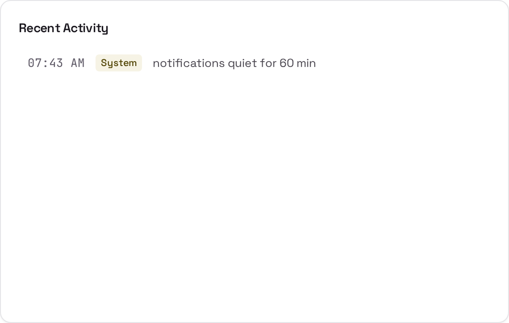
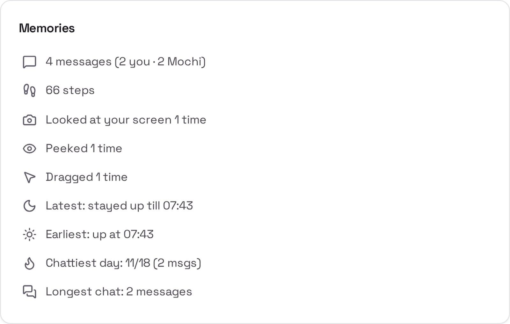
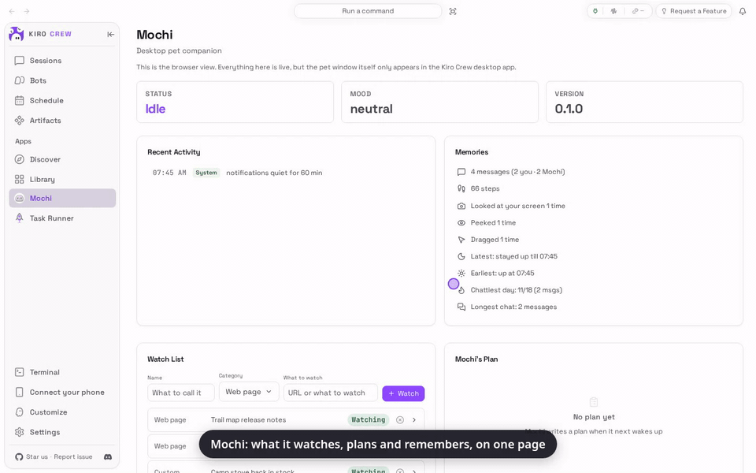

# Mochi

<picture>
  <source media="(prefers-color-scheme: dark)" srcset="docs/media/hero-dark.png">
  
</picture>

**A desktop pet that chats, keeps an eye on things for you, and stays quiet until something changes.**

Mochi is an app for [Kiro Crew](https://github.com/kirodotdev/KiroCrew),
the open-source personal AI agent.

## What it is

Once Mochi is on, a small animated pet lives on your desktop in the Kiro Crew
desktop app. You chat with it in its own panel, it watches web pages and feeds
you point it at, it plans its own day around your schedule, and it taps you on
the shoulder only when something actually changed. A **Mochi** page in Kiro
Crew's sidebar shows what it is doing: its mood, what it watches, its plan for
the day, what it did lately, and the time you have spent together.

**Get started:** open **Apps → Discover**, find **Mochi**, choose **Install**,
then **Enable**. See [Install](#install) for the details.

## The problem it solves

You want something to keep an eye on a few pages for you (a release page, an
alert feed, a product that is out of stock) without leaving tabs open and
checking them yourself, and without a stream of notifications for things that
did not change. Mochi checks them on its own schedule, merges what it has to
tell you, holds it while you are busy, and says something only when there is
something to say. You decide how busy its background checks may be, which
limits how many it runs an hour.

## Top 3 use cases

### 1. Watch a page until something changes

You are waiting for a new version of a map, a weather alert or a product to come
back in stock. You type a name and the address into the **Watch List** on the
Mochi page, or just ask Mochi in its chat panel to keep an eye on it. Mochi
checks it on its own, backs off when a site fails, and tells you once when what
you asked about has happened.



### 2. Keep it quiet while you focus

You are heading into an hour of focused work. Right-click the pet and choose
**Quiet for 1 hour**: Mochi holds its notifications (anything critical still
gets through) and hands you the rest, merged, when the hour is up or when you
choose **Resume notifications**. The page's
**Recent Activity** card shows when it went quiet.



### 3. Look back on your time together

Mochi remembers your time together: the messages you exchanged, how far it
walked across your screen, how often it peeked or looked at your screen, your
chattiest day and the longest chat, and it celebrates each milestone once. The
**Memories** card on the Mochi page shows them.



## Watch it



[Watch the walkthrough as a video (MP4)](docs/media/walkthrough.mp4).

<sub>Recorded from a real Kiro Crew (`5ec3b81677`) on a throwaway home with
made-up demo data, added through the app's own screens and API. No AI model was
connected, so Mochi's background agent did not run and its plan card is empty.
The desktop pet itself is drawn by the Kiro Crew desktop app, which was not
running.</sub>

## Install

**From the Kiro Crew App Store**

1. In Kiro Crew, open **Apps → Discover** in the left sidebar.
2. Search for **Mochi** and choose **Install**.
3. Kiro Crew asks **Trust “Mochi” to run its own code?** Mochi runs its own
   code inside Kiro Crew: the loop that plans its day and checks your watch
   list, and the tools its agents use. Trusting it gives that code the same
   access Kiro Crew has (your files, your saved sign-ins and the internet), as
   the dialog says. Choose **Trust this app**. You can take it back later in
   **Settings → Security → Third-party apps**.
4. The app installs switched off. Choose **Enable** on its page. It then shows
   up under **Apps** in the sidebar and in **Apps → Library**.

Mochi works on macOS, Windows and Linux. The pet and its chat panel appear only
in the **Kiro Crew desktop app**; in a browser you get the Mochi page. Kiro Crew
must already be able to chat: if ordinary chats work, Mochi's chats and
background checks work too, and they use your model the same way a chat does.
Planning around your schedule needs a calendar tool connected to Kiro Crew.

If you already had Mochi from an earlier Kiro Crew, it is moved onto this app
for you when Kiro Crew updates, with your pet, its settings, its watch list and
its memories kept. There is nothing to do.

## First run

The pet appears on your desktop and its chat panel opens once, so you can say
hello. The Mochi page shows **Idle** and a **neutral** mood, an empty watch list
(**Nothing being watched**), **No plan yet** until Mochi next wakes up, and no
memories yet. Start by adding one thing to watch.

## How to use it

1. **Chat:** press **⌘ Shift M** on a Mac (**Alt Shift M** on Windows and Linux)
   to open or close the chat panel, and talk to Mochi there.
2. **Watch something:** on the Mochi page, type a **Name**, pick a **Category**,
   type the address in **What to watch** and choose **Watch**. Choose the row to
   see its trigger, notes and the next check; the **⊗** button stops watching it.
3. **Change how it looks or behaves:** right-click the pet for the
   **Appearance Gallery**, **Settings** and **Quiet for 1 hour**. In Settings
   you choose its **Pet Name**, how busy its background checks may be
   (**Economy**, **Balanced**, **Active** or **No Limit**), which of your
   connected tools it may use (**MCP**) and its shortcuts.
4. **Hide it for a moment:** **⌘ Shift H** (**Alt Shift H** elsewhere) hides and
   shows every Mochi window. **⌘ Shift X** (**Alt Shift X**) takes a screenshot
   to show Mochi.

## Settings & data

- **Where your data lives:** `~/.kiro/crew/apps/mochi/data/` (or under
  `$KIROCREW_HOME` if you set it): the watch list, the plan, the pinned files,
  the memories, your settings and the avatars you imported.
- **What leaves your computer:** the pages and feeds you ask it to watch are
  fetched from their sites; its chats and background checks go to the model your
  Kiro Crew uses; importing an avatar from PetDex downloads it from
  `petdex.dev`. Nothing else.
- **Turn it off:** **Apps → Library**, open the **⋯** menu on Mochi, choose
  **Disable**. The pet goes away and your data is kept.
- **Remove it:** the same menu, **Uninstall**. **Keep app data** is ticked by
  default; untick it to delete the data too.

## Troubleshooting / FAQ

**I enabled Mochi but there is no pet on my desktop.**
The pet appears only in the Kiro Crew desktop app, not in a browser tab. If you
are in the desktop app, wait a few seconds: it checks for Mochi every few
seconds after you enable it.

**The Mochi page says "Enable this app from Apps to use it".**
Mochi is switched off. Open **Apps → Library** and choose **Enable** on Mochi.

**The plan card says "No plan yet".**
Mochi writes its plan when its background agent next wakes up, which needs
Kiro Crew to be able to chat. If ordinary chats work, the plan appears on its
own.

**Something I watch was not checked.**
Mochi checks each item on its own interval and waits longer after a site
fails. Choose the row on the Mochi page to see when the next check is due.

**The pet is gone and I do not know why.**
**⌘ Shift H** (**Alt Shift H** on Windows and Linux) hides and shows every Mochi
window. If that does not bring it back, check that Mochi is enabled in
**Apps → Library**.

## Development

The backend (the owner loop, its stores and the routes) runs inside the Kiro
Crew gateway through the manifest's `backend.hooks`; `backend/mcp_launch.py`
starts the stdio MCP server its agents call; `agents/` holds the two agents and
their skills; `ui/` is the dashboard page, built to the committed
`ui/dist/index.mjs`. [PORTING.md](PORTING.md) records how this repository was
moved out of Kiro Crew's built-ins and which Kiro Crew services it still reaches.

### Install from a clone

```bash
git clone https://github.com/KiroCrewCaptain/kirocrew-app-mochi
kirocrew app install ./kirocrew-app-mochi
```

`kirocrew app enable mochi` is refused with `app_execution_denied` until the app
is trusted, and there is no command-line trust step. Enable it from
**Apps → Library** instead: that opens the trust dialog, and **Trust this app
and enable** does both. `kirocrew app disable mochi` turns it off;
`kirocrew app uninstall mochi` keeps the data and adding `--purge-data` deletes
it.

### Tests

```bash
python -m pip install -r tests/requirements.txt
python -m pytest
cd ui && npm ci && npm run typecheck && npm test && npm run build
```

### Re-capture the README media

The pictures and the recording come from a real, isolated Kiro Crew gateway
driven by [`capture/`](capture/README.md). After any change to what the app shows:

```bash
python capture/capture.py --kirocrew /path/to/KiroCrew
python capture/check_readme.py
```

Then look at every image and at a few frames of the video before committing
(see [CHECKLIST.md](CHECKLIST.md)).

## License

Apache License 2.0. See [LICENSE](LICENSE) and [NOTICE](NOTICE).
